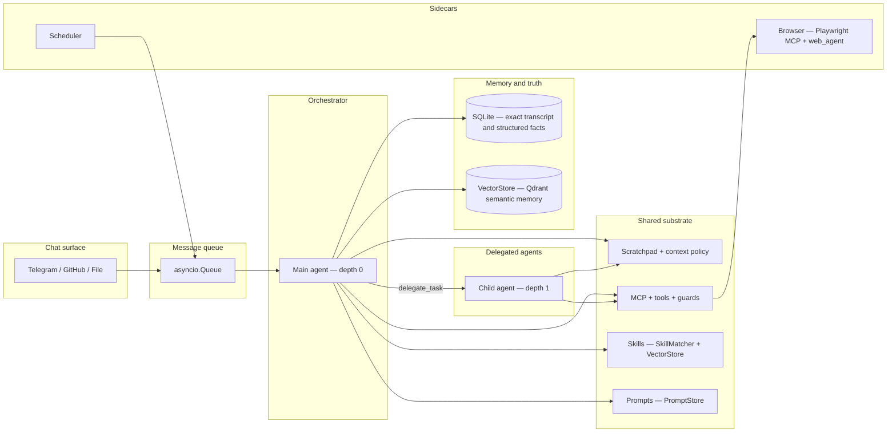
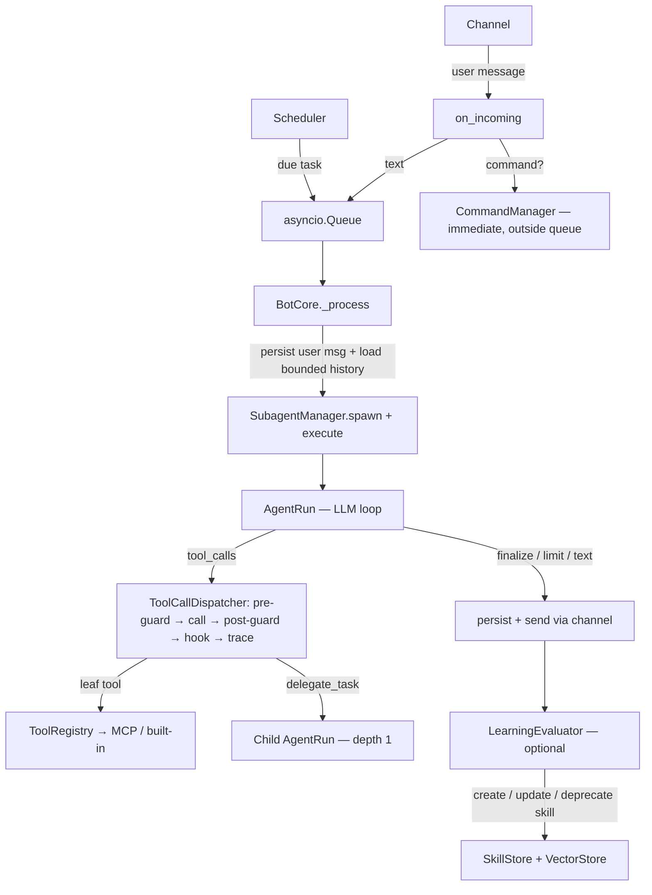

# NanoBot architecture

This document describes **what we are building**, **how context and capabilities are meant to fit together**, and **what the code does today** — verified against the code as of Oct 2026. For phased work and open questions, see [ROADMAP.md](ROADMAP.md).

---

## Vision

NanoBot is a **personal agent** you talk to over chat (Telegram today). It should run comfortably on **your own hardware or a small cloud slice**, so the design favors **efficiency** and **intelligent context management** over always-on huge prompts or heavyweight stacks.

The **main agent is an orchestrator**: it can **delegate** to child agents for focused jobs (research, a multi-step browser flow, a narrow sub-task). All agents share a common substrate: **tools and MCP servers**, a **scratchpad** (structured working memory with a protocol the harness enforces), and **durable stores** where each store has a clear job.

**Scope**: help with **browser-centric and API-shaped life tasks** — search, news, calendars, forms, logged-in sites when you allow it — not a "full machine" agent. More capable than "MCPs only" as a product story (orchestration, memory layers, scheduling), but **narrower and more controlled** than full-device assistants.

---

## Conceptual architecture

**Ideas encoded here**

- **Orchestrator vs workers**: the main agent (depth 0) can spawn one level of focused child agents via the `delegate_task` tool. Children cannot spawn grandchildren — depth is gated at three independent layers (see [Orchestration](#orchestration-delegate_task)). This shipped; it is no longer a roadmap item.
- **Scratchpad + context policy**: bounded chat history, explicit working notes, and rules for what gets promoted to long-term memory or kept only in-session. The scratchpad protocol (init → append after each tool result → finalize) is **enforced by the harness**, not left to the model's discretion.
- **Right store for the job**: **SQLite** for **exact** replay and structured data (messages, scheduler rows, plans, skills, prompts, tool stats, subagent runs); **ContextStore** (SQLite `contexts` table) for **mutable working state** (scratchpad, pointers, traces); **VectorStore** (Qdrant) for **associative** semantic recall across three collections (memories, skills, web_scripts).
- **Skills**: SkillStore for definitions and trigger configuration, SkillMatcher for injection, VectorStore for semantic skill lookup. The evaluator can auto-create or update skills from learnings.
- **Scheduler** alongside the agent: time-based nudges and jobs without blocking the chat loop.
- **Browser** as a first-class capability through **two systems**: the external **Playwright MCP** (standalone server, multi-tab support, auto-popup detection) and the built-in **web_agent** (`interact_page` MCP tool wrapping `BrowserInteractor`).
- **Message queue**: an `asyncio.Queue` sits between channels and core, serializing all incoming messages (user messages, scheduled tasks, subagent results) for ordered processing. **Slash commands are the exception** — they dispatch immediately, outside the queue, so `/stop` can cancel an in-flight run in the same scope.

---

## Context strategy (design intent)

| Layer | Role | Typical content |
| ----- | ---- | ---------------- |
| **Chat window** | What the model sees this turn | Recent messages, capped; system + scratchpad injection |
| **Scratchpad / context store** | Mutable working state | Plans, checklists, pointers, compact tool/browse traces |
| **SQLite** | Source of truth for exact data | Full transcript, schedule rows, plans, skills metadata, prompts, tool stats, subagent runs |
| **VectorStore (Qdrant)** | Long-horizon semantic recall | Facts, preferences, skill embeddings, web script embeddings across three collections |

Efficiency means **aggressive budgeting** (what goes into the prompt, how often, in what form) and **clear promotion rules** (what becomes a VectorStore memory vs what stays in scratchpad vs what is only in SQLite for audit).

---

## Capability map

| Capability | Role today | Notes |
| ---------- | ---------- | ----- |
| **Channels** | Telegram, GitHub, File (extensible pattern) | `Channel` + `set_handler` → `BotCore.on_incoming` |
| **Orchestration** | `delegate_task` tool, depth 0 → 1 only | Control-plane dispatch; spec prepended by `_list_openai_tools`; child gets focused system prompt, own scratchpad, own skill matching. See [Orchestration](#orchestration-delegate_task). |
| **Scratchpad** | Working memory in context store, per-run | Protocol enforced: init at start of work turns, append after each external tool result, finalize before answer. See [SCRATCHPAD.md](docs/SCRATCHPAD.md). |
| **Tool guards** | Pre-call schema validation + arg normalization; post-result checks | `SchemaValidationGuard` (all tools) + `WebScriptGuard` (script claims/results), host guards merged in. Bad shapes → structured error result, not silent corruption. |
| **MCP hub** | Tools (timer, scheduler, web, playwright, reddit …) | Namespaced tools; `McpHub.call_tool` via stdio MCP |
| **Browser** | Two systems: external Playwright MCP + built-in web_agent | External MCP: multi-tab, auto-popup detection, `switch_tab`. Built-in: `interact_page` tool via `BrowserInteractor`. Browse hooks record traces. |
| **Scheduler** | Due tasks → core callback | `SchedulerStore` + `SchedulerRunner` |
| **SQLite stores** | ConversationStore, ContextStore, scheduler, plans, skills, prompts, tool stats, subagent runs, notebook | Exact history, blobs, and structured metadata |
| **VectorStore** | Native multi-collection store over Qdrant (memories/skills/web_scripts) | 7 direct built-in `memory__*` tools registered via `register_memory_tools`; not an MCP server |
| **Retrieval (fragmented today)** | Three one-off paths: dense-only memories, dense-only skills, token-overlap scripts; web outputs never indexed | Unification planned — one hybrid BM25+dense retrieval service with RRF, plus an artifact registry indexing every web output with run-level provenance. See [ROADMAP.md](ROADMAP.md) Phase E. |
| **Skills** | SkillStore + SkillMatcher + semantic index | Trigger matching (always/pattern/intelligent); evaluator-driven lifecycle; vector-backed semantic lookup |
| **Evaluator** | Three-phase skill lifecycle evaluator | Quality → learning → lifecycle, quality-gated; enabled via `enable_evaluator: true`. See [EVALUATOR.md](docs/EVALUATOR.md). |
| **Plans** | PlanStore + 5 plan tools | Structured plans with success/failure tracking per step |
| **Web scripts** | Sandboxed extraction scripts + `web_scripts` VectorStore collection | AST validator blocks unsafe imports/calls; scripts semantically searchable and reusable |
| **Notebook** | Bot-owned SQLite notebook via `notebook__query` | For emergent structured data the bot should remember |
| **PromptStore** | Centralized prompt templates | Versioned, variable rendering, sync script + just recipes |
| **Cancellation** | `/stop` → CancellationToken → LLM child-tokens | Pre-queue command dispatch lets /stop cancel an in-flight run; tokens propagate to delegated children. |

---

## Runtime flow (message → reply)

**Step by step:**

1. **Incoming** — A channel calls `emit(IncomingMessage)` → `BotCore.on_incoming`. Slash commands dispatch immediately via `asyncio.create_task` (so `/stop` can cancel a running request in the same scope); everything else is enqueued as `UserMessage`. The scheduler enqueues due tasks as `ScheduledTaskMessage`; subagent results arrive as `SubagentResultMessage`. The queue serializes all three, preventing concurrent runs on the same scope.
2. **Dispatch** — `_process_queue_loop` dequeues one message at a time → `_process(scope, text, user_id)`.
3. **Run spawn** — `_process` persists the user message, loads bounded history (`history_message_limit` messages, then `history_char_limit` chars), builds system messages (static prefix first for prompt caching), then `spawn()` creates a `SubagentRun` record and `execute()` hands off to `AgentRun`. Every message goes through a run — the "main agent" and "subagent" are the same machinery.
4. **AgentRun loop** — Each round: call LLM with tools → if tool calls, dispatch each through `ToolCallDispatcher` (guards → call → hook → trace) → loop; if text, exit with reply. Scratchpad writes are intercepted in-process; `delegate_task` calls spawn a child run. Four exit paths (see below).
5. **Reply** — Persist assistant message, update context pointers, send via channel. Empty replies fall back to a fixed message (logged).
6. **Evaluate** — After the reply is sent, `_evaluate_turn` runs the `LearningEvaluator` (if enabled), which may create/update/deprecate skills.

### Orchestration: delegate_task

The orchestrator (depth 0) spawns focused children (depth 1) via the `delegate_task` tool. A child is a full `AgentRun` with:

- A separate context — no inherited user history; fresh messages built from the `subagent_delegated` prompt + goal.
- Its own scratchpad (keyed by its own `run_id`) and its own skill matching.
- The same MCP tool surface, minus `delegate_task` itself.

**Depth gating is triple-layered** (defense in depth, not a single check):

1. **Spec strip** — `AgentRun._tools_for_chat` removes the `delegate_task` spec from the tool list the depth-1 LLM sees (`agent_run.py`).
2. **Spawn refusal** — `SubagentManager.spawn` raises if depth would exceed `MAX_SUBAGENT_DEPTH` (1) (`subagents/manager.py`).
3. **Dispatch refusal** — `run_delegate_task` independently refuses if `depth >= 1` (`subagents/delegate_tool.py`).

The dispatch model mirrors `session__scratchpad_write`: the spec is prepended to the LLM tool list by `_list_openai_tools`, and the LLM loop intercepts the call in `ToolCallDispatcher.dispatch`, passing scope/run_id/cancel_token explicitly — no shared state on BotCore. See issue #43.

### Tool guards

Two built-in guards wrap every non-scratchpad tool call:

- **SchemaValidationGuard** (pre-call) — Resolves the tool's JSON schema and validates the LLM's arguments against it; malformed args are blocked with a structured `{"ok": false, "error": …}` result the model can correct, instead of reaching the tool and failing opaquely. Also normalizes common arg shapes (e.g. scalar params passed as strings, `schedule_task` chat_id placeholders).
- **WebScriptGuard** (pre + post) — Catches JavaScript submitted as a Python web script, unusable web data being marked as "saved", and similar script-flow lies.

Host-provided guards are merged in and deduped by class. Guard failures produce a blocked call result, never a crash of the loop.

### Agent loop exit paths

The tool-calling loop has four exit conditions. Two use the scratchpad to produce a final answer:

1. **Implicit text response** — Model returns no `tool_calls`; loop exits with the text reply.
2. **Scratchpad finalize** — `scratchpad_write(mode=finalize)` breaks the loop and makes one no-tools LLM call with the `finalize_response` prompt (goal + summary from scratchpad). See [SCRATCHPAD.md](docs/SCRATCHPAD.md).
3. **Tool call limit** (30) — Soft landing: no-tools LLM call with `tool_call_limit_finalize` prompt so the model can summarize partial progress.
4. **Identical tool call repeat** (3x) — Hard abort with a fixed error reply.

Two additional invariants protect the loop:

- **Scratchpad protocol enforcement** — After an external tool result, the model must call `session__scratchpad_write` (append or finalize) before requesting another external tool. Violations get a correction message, capped at 2 retries, then abort. See [SCRATCHPAD.md](docs/SCRATCHPAD.md).
- **Empty reply fallback** — An empty/whitespace LLM reply is replaced with a fixed fallback message (and logged), never sent as-is.

### Message-history surgery

Long tool loops trim the in-flight message list: messages between the first assistant tool-call and the last one are dropped (`prepare_messages_for_chat` + trim helpers in `agent_run.py`), keeping system + recent context. Consecutive same-role messages are merged (role normalization).

### Cancellation

`/stop` (any scope with an active request) sets the scope's `CancellationToken`. The token is checked before each LLM call and raced against the HTTP call itself, so a stuck generation doesn't block cancellation. Delegated children receive child tokens; cancelling the parent cancels the child mid-generation. On cancellation the user sees "Request was cancelled." and the run is recorded as `cancelled`.

### After turn: evaluator

After each completed run, the `LearningEvaluator` runs (if enabled) and may auto-create or update skills. See [EVALUATOR.md](docs/EVALUATOR.md) for the pipeline.

---

## Component map

| Component | Source | Role |
|-----------|--------|------|
| **BotCore** | `core.py` | Orchestrator: message queue, command dispatch, evaluator integration |
| **LlmClient** | `llm.py` | OpenAI-compatible chat completions client, all LLM I/O logged via `nanobot.llm.io` |
| **AgentRun + ToolCallDispatcher** | `agent_run.py` | LLM chat loop, scratchpad protocol, tool dispatch with guards |
| **SubagentManager** | `subagents/` | Spawn/execute subagent runs; depth-gated; observability tracking |
| **CommandManager** | `core_commands/` | Slash commands: help, ctx/ctxfull, reset, plan, scratchpad, reload, session, status, stop |
| **Scratchpad** | `core_scratchpad.py` | Per-run structured working state (goal, steps, facts, tool journal) |
| **SkillMatcher** | `skills/matcher.py` | Resolves which skills to inject (always/pattern/intelligent) |
| **LearningEvaluator** | `evaluator/` | Turns good conversations into skills (quality → learning → lifecycle) |
| **McpHub** | `mcp_hub.py` | Connects to configured MCP servers, routes tool calls |
| **ToolRegistry** | `tools/` | Registers and dispatches all tools (MCP + built-in), records stats |
| **PromptStore** | `prompts/` | Centralized prompt templates with variable rendering |
| **SchedulerRunner** | `scheduler_runner.py` | Polls due tasks from scheduler DB, enqueues to BotCore |

Dedicated docs cover the non-obvious subsystems in detail: [SCRATCHPAD.md](docs/SCRATCHPAD.md), [SKILLS.md](docs/SKILLS.md), [EVALUATOR.md](docs/EVALUATOR.md), [CHANNELS.md](docs/CHANNELS.md), [WEB_AGENT.md](docs/WEB_AGENT.md), [MCP_SERVERS.md](docs/MCP_SERVERS.md), [REDDIT.md](docs/REDDIT.md), [logging.md](docs/logging.md), [CANCELLATION.md](docs/CANCELLATION.md).

---

## Storage boundaries

| Store | File | Table / collection | Purpose |
| ----- | ---- | ----- | ------- |
| **ConversationStore** | `memory.py` | `messages` | Full chat transcript |
| **ContextStore** | `context_store.py` | `contexts` | Scoped JSON — scratchpad (under `subagent_run:{run_id}`), pointers, traces, run status/result |
| **SchedulerStore** | `scheduler_store.py` | `scheduled_tasks` | Time-based task queue |
| **SubagentRunStore** | `subagents/store.py` | `subagent_runs` | Run metadata (scope, status, timing, `parent_run_id` → depth chain) |
| **ToolStatsStore** | `tools/stats.py` | `tool_calls` | Tool invocations with `run_id` link, previews only |
| **PromptStore** | `prompts/store.py` | `prompts` | Centralized prompt templates (versioning, variable rendering) |
| **PlanStore** | `plans/store.py` | `plans` | Structured plans with steps and success/failure tracking |
| **SkillStore** | `skills/store.py` | `skills` | Skill definitions and trigger configuration |
| **NotebookStore** | `notebook/store.py` | `notebook` | Bot-owned emergent structured data |
| **VectorStore** | `vector_store/store.py` | Qdrant collections | Multi-collection vector storage (memories, skills, web_scripts) |

**Key relationships:**

- `subagent_runs.id` ← `tool_calls.run_id` — Links tool calls to specific runs
- `subagent_runs.parent_run_id` — Delegation chain (root = None; depth 1 = delegated child)
- `contexts` — Per-run scratchpad under `subagent_run:{run_id}`; run status/result/skill injection under the same scope
- `messages` — Transcript only: user and final assistant text; tool I/O lives in `tool_calls` (previews) and `nanobot.llm.io` logs (full payloads)

---

## Hooks

Three integration points connect components to the core:

- **Channel → core**: `Channel.set_handler` → `BotCore.on_incoming` → `UserMessage` enqueued (commands dispatch immediately).
- **Scheduler → core**: `SchedulerRunner(on_due_task=...)` → `ScheduledTaskMessage` enqueued (serialized with user messages via `asyncio.Queue`). `mark_ran(task_id, cron_expr)` is called at enqueue time to prevent re-enqueue on the next poll cycle.
- **After each tool call**: `ToolHook.after_tool_call(event, bot)` dispatched by `BotCore._dispatch_after_tool_call`. Built-in hooks: `ToolResultRecorderHook` (all tool calls → tool_calls stats table), `BrowseEventRecorderHook` (`playwright__*` only), `FileTraceHook` (conditional, when FileChannel has `capture_tool_calls=true`).

**Event fields**: `scope`, `call_id`, `tool_name`, `args`, `result`, `result_preview`, `ok`, `error`, `at`.

**Policy**: Hook failures are isolated; a failing hook must not break the tool loop or the user turn.

Future hooks (suggested, not contracted): `before_tool_call`, `on_turn_complete`, `on_error`.

---

## Observability: what is and isn't traced

Today's observability is **log-based, not query-based**:

| Signal | Where | Persists? | run_id? |
|---|---|---|---|
| Full LLM request/response payloads | `nanobot.llm.io` logger → `data/llm.log` | Until rotation (5MB × 5 backups) | No — scope tag in log text only |
| Tool calls (200-char previews) | `tool_calls` SQLite table | Yes | Yes |
| Run metadata + status + goal | `subagent_runs` SQLite table | Yes | Yes (row key) |
| Scratchpad state | `contexts` table, per run | Yes | Yes |
| Evaluator LLM I/O | `nanobot.evaluator.io` → `data/evaluator.log` | Until rotation | No |
| Final transcript | `messages` table | Yes | No |

**Known gap (issue #35)**: LLM calls are not persisted to SQLite and don't carry `run_id` correlation. You cannot join "every LLM round in run X" with its tool calls and scratchpad states after log rotation, and there is no per-run token accounting. The `nanobot.llm.io` INFO lines already capture the shape (scope tag, token counts, finish_reason, elapsed) — what's missing is a table and a join key. This is the first code piece on the roadmap (see [ROADMAP.md](ROADMAP.md) Phase D).

---

## Related documents

- [ROADMAP.md](ROADMAP.md) — Phases, milestones, and open design choices.
- [docs/SCRATCHPAD.md](docs/SCRATCHPAD.md) — Scratchpad lifecycle, modes, protocol enforcement, and limits.
- [docs/SKILLS.md](docs/SKILLS.md) — Skill schema, trigger modes, matching, and CRUD tools.
- [docs/EVALUATOR.md](docs/EVALUATOR.md) — Three-phase evaluation pipeline and fault tolerance.
- [docs/CHANNELS.md](docs/CHANNELS.md) — Channel interface and how to add a new one.
- [docs/WEB_AGENT.md](docs/WEB_AGENT.md) — Dual browser system, actions, and content extraction pipeline.
- [docs/logging.md](docs/logging.md) — Logging configuration, per-module handlers, and LLM call logging.
- [docs/CANCELLATION.md](docs/CANCELLATION.md) — CancellationToken design.
- [docs/MCP_SERVERS.md](docs/MCP_SERVERS.md) — MCP server configuration reference.