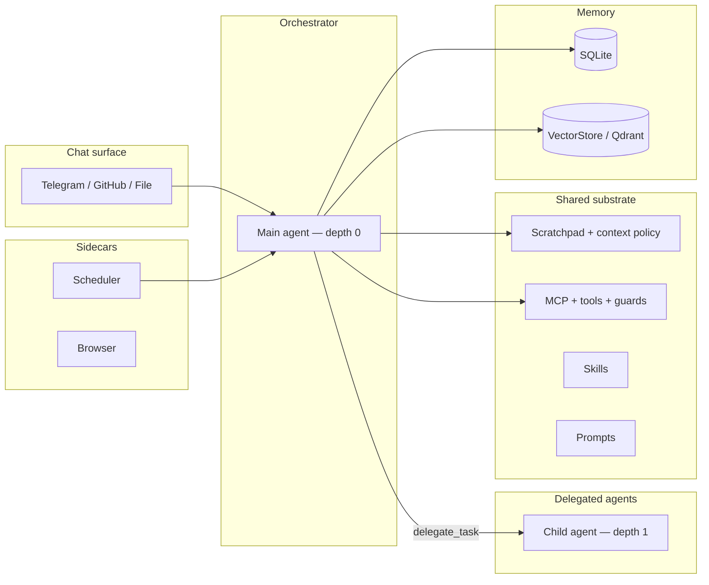

# nanobot

A personal AI agent that orchestrates delegated agents, browses the web autonomously, runs sandboxed scripts, and learns from every conversation — all on your own hardware, over a chat interface.

## Why nanobot?

I wanted an AI assistant that actually lives on my machine — no cloud dependency, no vendor lock-in, no sending everything to someone else's API. Something that remembers what I care about, can browse the web for me, and gets better at helping over time.

NanoBot runs locally, talks to local LLMs (Ollama, vLLM, LM Studio, anything OpenAI-compatible), and keeps a scratchpad so it doesn't lose track mid-conversation — structured working state for its goal, current step, and what it's learned from tools so far, with a protocol the harness enforces. Longer-term memory: SQLite for exact history, and a native vector store (Qdrant) for semantic recall of facts, skills, and web scripts. It doesn't try to be a full operating system — it handles the things I actually need help with through chat: searching, browsing, scheduling, running scripts, and delegating multi-step work to focused subagents.

## Key concepts

- **Channels** — Telegram, GitHub, and FileChannel all share a common `Channel` abstraction. Messages from any surface flow through the same orchestrator. Slash commands dispatch immediately (outside the queue) so `/stop` can cancel an in-flight run.
- **Orchestration** — The main agent (depth 0) spawns focused child agents (depth 1) via `delegate_task`, each with a fresh context, its own scratchpad and skill matching, and the same tools minus delegation. Depth is gated at three independent layers.
- **Scratchpad** — Structured working memory during a run: goal, current step, accumulated facts, and a tool journal. Init at start, append after each tool result (harness-enforced), finalize before the answer. See [docs/SCRATCHPAD.md](docs/SCRATCHPAD.md).
- **Tool guards** — Every tool call passes a pre-call schema validation and post-result guard layer. Malformed arguments get a structured error the model can correct; script-flow lies (JS submitted as Python, "saved" claims on unusable data) are blocked.
- **Skills** — Auto-learned behaviors that persist across conversations. Three trigger modes, and a learning evaluator extracts new skills from good turns. See [docs/SKILLS.md](docs/SKILLS.md).
- **Memory** — SQLite for exact transcript and structured facts. Native multi-collection VectorStore over Qdrant (memories / skills / web scripts) with seven built-in `memory__*` tools.
- **Notebook** — A bot-owned SQLite notebook (`notebook__query`) for emergent structured data the bot should maintain itself.
- **MCP extensibility** — Plug in any Model Context Protocol server for new capabilities. Built-in servers for timer, scheduler, web, reddit, and browser automation via Playwright. See [docs/MCP_SERVERS.md](docs/MCP_SERVERS.md).

## How it works



Messages flow from channels through an async queue into the orchestrator, which spawns a tracked run for every message, dispatches tool calls through the guard layer, and can delegate focused sub-tasks to child agents. After each turn, the learning evaluator may extract skills from the conversation.

> For full architecture details — runtime flow, orchestration and depth gating, tool guards, storage boundaries, exit paths, and observability state — see [ARCHITECTURE.md](ARCHITECTURE.md).

## Features

### Multi-channel

Telegram, GitHub, and FileChannel share a common `Channel` abstraction. Messages from any channel flow through the same orchestrator.

### Orchestration via delegate_task

The main agent spawns focused child agents for sub-tasks that benefit from an isolated scratchpad and fresh skill matching. Children can't spawn children — depth is capped at 1 and enforced at three layers (tool-spec strip, spawn refusal, dispatch refusal).

### Skills system

Three trigger modes: `always` (inject every turn), `pattern` (regex match), `intelligent` (semantic similarity via vector store). The bot manages its own skills at runtime through CRUD tools.

### Learning evaluator

Three-phase pipeline: quality assessment, learning extraction, and skill lifecycle (create/update/deprecate). Over time, the evaluator turns good conversations into reusable skills. Enable via `enable_evaluator: true` in config. See [docs/EVALUATOR.md](docs/EVALUATOR.md).

### Plans

The `/plan` command and five `plan__*` tools create structured plans with steps, constraints, and success/failure tracking.

### Web scripts / NanoScripts

Sandboxed Python extraction scripts stored via MCP tools. An AST validator blocks unsafe imports and calls (imports are allowlisted; `os`, `subprocess`, `socket`, and dangerous builtins are blocked). Scripts are indexed for semantic search, so the bot can find and reuse relevant scripts automatically.

### Notebook

`notebook__query` gives the bot its own SQLite notebook for structured data it discovers while working (lists, tallies, small tables) — persisted, queryable, and owned by the bot.

### Memory & vector store

Native `VectorStore` backed by Qdrant with three collections: memories (facts/preferences), skills (skill embeddings), and web_scripts (script embeddings). Seven built-in memory tools handle search, save, update, and health — direct built-in tools, not an MCP server.

**Embedding dimensions must match.** `embedding_dims` in the embedder config must equal the model's actual output. `mxbai-embed-large` = 1024 dims. Must also match `embedding_model_dims` in the vector_store config. If you change embedding models, re-create Qdrant collections. Recommended: `mxbai-embed-large` (1024 dims, best quality) or `nomic-embed-text` (lighter/faster fallback).

## Quick start

1. Install [uv](https://docs.astral.sh/uv/) and [just](https://github.com/casey/just), then set up:

```bash
just setup
```

2. Copy config and set env vars:

```bash
cp config.example.yaml config.yaml
export TELEGRAM_BOT_TOKEN="..."
```

3. Run:

```bash
just run
```

An OpenAI-compatible endpoint serving embedding models (e.g. LM Studio, Ollama) must be running at the configured URL for memory, skills, and web scripts to work. See `config.mem0.yaml` for embedder settings.

## MCP servers

All MCP servers are configured as `mcp_servers` entries in `config.yaml` (see `config.example.yaml` for full format). Optional servers that need credentials go in `config.override.yaml` (git-ignored). See [docs/MCP_SERVERS.md](docs/MCP_SERVERS.md) for the full configuration reference.

| Server | Command | Tools |
|--------|---------|-------|
| timer | `python -m nanobot.mcp_servers.timer.server` | `time_now`, `time_epoch` |
| scheduler | `python -m nanobot.mcp_servers.scheduler.server` | `schedule_task`, `list_tasks`, `delete_task`, `pause_task`, `resume_task`, `cron_list`, `cron_add`, `cron_remove` |
| web | `python -m nanobot.mcp_servers.web.server` | `web__search_web`, `web__read_page` (Tavily/Exa API key required for search) |
| playwright | `npx -y @playwright/mcp@latest --browser chrome --headless` | Browser navigation, click, type, extract (requires Node.js 18+, Chrome) |
| reddit | `python -m nanobot.mcp_servers.reddit.server` | `reddit_get_posts`, `reddit_get_post`, `reddit_search`, `reddit_get_subreddit`, `reddit_health` (no auth needed, see [docs/REDDIT.md](docs/REDDIT.md)) |

## Web agent

The `interact_page` tool (via `src/web_agent/`) provides structured page interaction with multi-tab support, wrapping `BrowserInteractor` for Playwright-based navigation and extraction.

| Action | Fields | Notes |
|--------|--------|-------|
| `click` | `target` | Auto-detects new tabs |
| `type` | `target`, `text` | |
| `select` | `target`, `value` | |
| `scroll` | `amount` or `until_text` | |
| `wait_for` | `selector` or `text` | |
| `switch_tab` | `index` | Return to a background tab by index |

## Debug CLI

```bash
just scopes              # list message scopes
just ctx <scope>         # context report for a scope
just scheduler-list      # scheduled tasks
just plan-list           # recent plan runs
```

Full command reference: `just --list`. For direct CLI usage, see `uv run python -m nanobot.debug_cli --config config.yaml --help`.

## Quick reset

```bash
just reset              # clear scheduler + history + context + mem0
just reset-dry          # preview counts only
just reset-local        # clear local SQLite only, keep mem0
```

After a reset, re-index intelligent skills:

```bash
just resync-skills
```