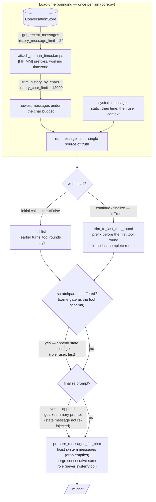
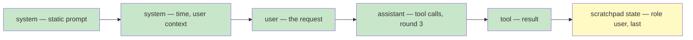
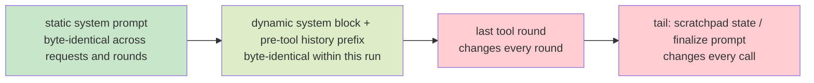

# Message Assembly

Every LLM call — the initial call, every continue round, every finalize — gets its prompt from **one assembly path**. The in-run `messages` list is the single source of truth: the prepared prompt is derived inside that path immediately before each call and never carried across loop iterations. This doc describes what the pipeline does; the *why* (structural surgery instead of windowing or summarization) is [ADR-0005](decisions/ADR-0005-message-history-surgery.md).

## Load-time bounding

Once per run, the caller (BotCore) builds the starting message list from persisted history (`core.py`):

1. **Message count.** `get_recent_messages(scope, limit=history_message_limit)` — the 24 most recent messages for the scope from the ConversationStore, including the just-persisted user message.
2. **Timestamps.** `attach_human_timestamps` prefixes each message's content with a `[HH:MM]` line in the working timezone. This runs *before* the character trim, so prefixed content counts against the budget.
3. **Character budget.** `trim_history_by_chars` accumulates newest-first until `history_char_limit` (12,000 characters of message content) is reached and drops everything older. The newest message is always kept, even if it alone exceeds the limit.
4. **System messages.** Prepend the system block, static bytes first (see [Prompt caching layout](#prompt-caching-layout)): the static identity prompt (`orchestrator_main`), then the dynamic block (`orchestrator_main_time`: current time), then per-user context (`orchestrator_user_context`) when a user id is known.

This is a coarse, lossy outer bound. Exactness is preserved in the ConversationStore; only the loaded window pays the prompt cost.

## Per-call surgery

Inside the run (`agent_run.py`), every `llm.chat` goes through `_build_chat_messages`:

1. **Trim — except on the initial call.** `trim_to_last_tool_round` keeps everything before the *first* tool round plus the *last* complete tool round, and drops everything in between. The initial call is deliberately untrimmed: the caller's history may contain earlier turns' tool rounds, which carry context this run needs.
2. **Scratchpad state message.** When the scratchpad tool is offered (same gate as the tool schema — see [SCRATCHPAD.md](SCRATCHPAD.md)), the current state is rendered from the `scratchpad_user` template as a **user-role message appended last**, so the prompt ends on the state with an explicit next instruction.
3. **Finalize prompts.** The scratchpad finalize and the tool-call-limit soft landing append a no-tools prompt built from the scratchpad: goal plus a summary of `context`, `current_step`, up to 15 `known_facts`, and up to 10 `tool_journal` entries. On these calls the state message is *not* re-injected — the summary already carries it.
4. **`prepare_messages_for_chat`.** Hoist every system message to the front in order (empty ones dropped — a mid-run protocol correction thus lands with the other system messages), then merge consecutive same-role messages (user/user, assistant/assistant) with blank-line joins. System and tool messages are never merged.

## What the trim keeps

A run in its fourth round, with three completed tool rounds in the message list:

After the trim and injection, the round-4 prompt is:

Rounds 1–2 disappear from the prompt — their findings survive only through the scratchpad (`known_facts`, `tool_journal`), which is why a skipped or thin append is real information loss (see [ADR-0002](decisions/ADR-0002-asymmetric-protocol-enforcement.md)). The cut lands on round boundaries by construction, so an assistant message with `tool_calls` is never separated from its tool results.

## Prompt caching layout

OpenAI-compatible runtimes cache prompts by **identical leading bytes**. The assembly orders every prompt stable-first, volatile-last:

Two stability levels:

- **Across requests**, only the static `orchestrator_main` prefix matches — the time block changes every request, which is exactly why the system prompt is split into static and dynamic parts instead of one rendered blob.
- **Within a run**, everything up to the last tool round (system block, user request, earlier-turn text) is byte-identical round over round, so round *N* re-pays only the last round and the tail.

## Invariants

- Rounds are never split: an assistant message carrying `tool_calls` always reaches the model together with its tool results.
- The user's request always survives the trim: it lives before the first tool round.
- System messages always lead; empty system content is dropped.
- Volatile content lands last: scratchpad state message and finalize prompts.
- The prepared prompt is derived inside the one assembly path per call and never carried across loop iterations — a stale prepared list is precisely how a mid-run correction message can silently fail to reach the model.
- Role merging never touches `system` or `tool` messages.

## Knobs and templates

| Knob / template | Default | Where |
|-----------------|---------|-------|
| `history_message_limit` | 24 messages | `config.yaml` (`config.py`) |
| `history_char_limit` | 12,000 characters | `config.yaml` (`config.py`) |
| `orchestrator_main` (static), `orchestrator_main_time`, `orchestrator_user_context` | system block | `prompts/defaults.py`, overridable in the PromptStore |
| `scratchpad_user` | scratchpad state message | `prompts/defaults.py` |
| `finalize_response`, `tool_call_limit_finalize` | no-tools finalize prompts | `prompts/defaults.py` |

Implementation: `src/nanobot/agent_run.py` (`trim_to_last_tool_round`, `_normalize_roles`, `prepare_messages_for_chat`, `_build_chat_messages`), `src/nanobot/core.py` (load-time bounding, `_system_messages`), `src/nanobot/core_utils.py` (`trim_history_by_chars`, `attach_human_timestamps`).

Related records: [ADR-0005](decisions/ADR-0005-message-history-surgery.md) (why surgery, not windowing or summarization) · [SCRATCHPAD.md](SCRATCHPAD.md) (state format and protocol gating) · [ADR-0004](decisions/ADR-0004-four-graded-exit-paths.md) (which calls are finalize calls).