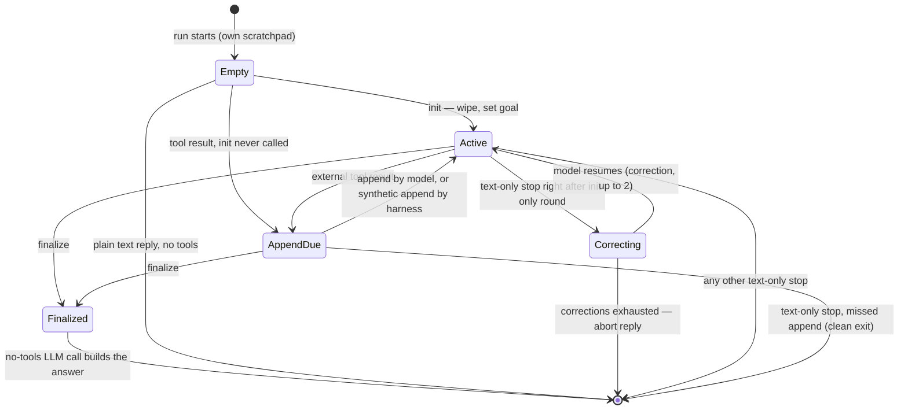

# Scratchpad

Structured working memory for the bot's turn — how it keeps track of goals, progress, and findings during multi-step tasks.

## Why the scratchpad exists

Small, locally-run models have a limited context window, and the practical limit is lower still: generation slows as the prompt grows, and quality degrades much sooner than a large model's. In long tool-calling chains they lose track: which step of the plan they are on, what earlier tool results found, whether the work is actually done. History trimming makes this worse — intermediate tool results are dropped from the in-flight message list, so anything the model did not write down is gone by the time the final answer is generated.

The scratchpad is where it writes that down: a structured record — goal, current step, next step, learned facts, tool journal — with every field clipped to a fixed budget and re-injected into each prompt at bounded cost, no matter how long the tool chain gets. Because a small model will not keep this discipline on its own, the harness enforces the update protocol (see [Scratchpad protocol enforcement](#scratchpad-protocol-enforcement)).

The pattern is what Anthropic calls **structured note-taking** — "a technique where the agent regularly writes notes persisted to memory outside of the context window," pulled back into it at later times ([Effective context engineering for AI agents](https://www.anthropic.com/engineering/effective-context-engineering-for-ai-agents)). Two differences: the scratchpad is per-run working state isolated by `run_id` (see [Storage and scope isolation](#storage-and-scope-isolation)), and the protocol is enforced by the harness rather than left to the model's discretion.

## State fields

| Field | Type | Limit | What it holds |
|-------|------|-------|---------------|
| `goal` | string | 600 chars | What the bot is trying to accomplish this turn |
| `context` | string | 1200 chars | Running summary of progress and key information |
| `known_facts` | string[] | 30 items, 600 chars each | Facts extracted from tool results |
| `current_step` | string | 600 chars | What the bot is doing right now |
| `next_step` | string | 600 chars | What the bot plans to do next |
| `tool_journal` | string[] | 30 items, 600 chars each | Log of tools called and what they returned |
| `updated_at` | string | — | Auto-set timestamp (bot timezone) |

All string fields are clipped to their limits. Arrays are deduplicated and keep only the most recent entries.

## Storage and scope isolation

The scratchpad lives in the `contexts` table, keyed by run:

- Inside a subagent run: `contexts(scope_type="subagent_run", scope_id=run_id, key="scratchpad")` — **every run gets its own scratchpad**, so concurrent runs on the same chat scope never clobber each other's working state.
- Outside any run (e.g. the `/scratchpad` command): falls back to `contexts(scope_type="chat", scope_id=scope, key="scratchpad")`.

Each new run starts with an empty scratchpad — there is no cross-turn carry-over and nothing to clear at turn start. (This replaced the old design where a single chat-scoped scratchpad was cleared at the start of each user message; per-run isolation is what makes concurrent runs on the same scope — e.g. a user message and a scheduled task arriving together — safe. Without it, both runs would overwrite each other's goal and both would loop without reaching finalize.)

## Mode lifecycle

Three modes, corresponding to the phases of a task. The full per-turn state machine — including the protocol transitions — looks like this:



**AppendDue** is not stored scratchpad content — it is a harness flag meaning an external tool result has arrived and no append has followed. While it is set (and at the first call of a turn), the scratchpad tool is offered to the model; after a write it is removed from the schema until the next tool result. Its user-role state message follows the same gate. **Correcting** is the strict recovery path described in [Scratchpad protocol enforcement](#scratchpad-protocol-enforcement). The remaining loop exits — the tool-call limit and the identical-repeat abort — are listed in [Finalize and exit paths](#finalize-and-exit-paths).

### `init`

Called at the start of a work turn. Resets the scratchpad to empty state and sets the goal. Any existing scratchpad content is wiped.

```json
{"mode": "init", "goal": "Find the weather in Bangkok and compare with yesterday"}
```

### `append`

Called after each tool result (and before the next tool call). Updates fields incrementally — new `known_facts` and `tool_journal` entries are appended and deduplicated, not replaced. Other fields (`goal`, `context`, `current_step`, `next_step`) are overwritten if provided.

```json
{"mode": "append", "current_step": "Looked up Bangkok weather", "next_step": "Compare with yesterday", "known_facts": ["Bangkok: 34°C, humid"]}
```

### `finalize`

Signals that the bot has gathered everything it needs and no more tool calls will follow. The scratchpad state is preserved, and the agent loop makes one explicit no-tools LLM call using the `finalize_response` prompt template — which includes the goal and a summary built from the scratchpad's `context`, `known_facts`, and `tool_journal`.

```json
{"mode": "finalize", "context": "Bangkok 34°C today vs 31°C yesterday, 3°C warmer"}
```

**Critical**: Finalize means finalize. Once called, the model cannot use tools. All key findings must be in the scratchpad *before* finalizing, because the final answer is built from the scratchpad summary — anything missing is lost.

## Scratchpad protocol enforcement

The scratchpad isn't optional for tool-calling turns. After every external tool result, the model must call `session__scratchpad_write` (append or finalize) before requesting another tool. This is the **scratchpad protocol**.

The enforcement loop (`ScratchpadProtocolState` in `agent_run.py`) tracks two cross-round facts: whether an **append is due** (an external tool result arrived since the last scratchpad write) and whether the previous round was **init-only** (init was called, but no external tool and no finalize followed). The protocol can be broken in two directions, and they are enforced at different strictness because they differ in what is recoverable:

- **Skipped the append (relaxed)** — after real tool work, the model requests another external tool without a scratchpad write in between. The work happened; only the notes were skipped. The harness writes a **synthetic append** itself, built from the model's own content (thinking tags stripped), logs the violation, and lets the round proceed. Not blocking.
- **Narrative without work (strict)** — the model called `mode=init`, then stopped with a text answer without ever using a tool or finalizing. Nothing was done, so the answer is a hallucinated completion and must not reach the user. The harness injects a correction system message and re-offers the scratchpad tool, up to 2 times (`MAX_SCRATCHPAD_PROTOCOL_RETRIES`):

  > Protocol violation: after any external tool result, call session__scratchpad_write first (mode='append' or mode='finalize') before requesting another external tool.

  If the model still stops, the turn aborts with a fixed safe reply:

  > I got stuck enforcing scratchpad updates in this turn. Please try again.

Two things are deliberately **not** enforced. A text-only stop after real tool work is a clean exit — the missing append just means the notes are staler than the transcript. And nothing forces an init: a work turn that never called `mode=init` simply runs without a scratchpad.

The strongest mechanism is the tool surface itself: `session__scratchpad_write` is offered to the model only while an append is due — after a write it disappears from the tool schema until the next tool result makes it due again. This also guards against over-compliance: when the tool was always present, small models sometimes looped on scratchpad writes and burned the token budget on bookkeeping instead of work.

## How the scratchpad is injected

The scratchpad appears in the prompt in two places:

1. **System message** (`scratchpad_system` template) — full scratchpad state as JSON, labeled as private execution state that should never be revealed verbatim to the user.
2. **User-role message** (`scratchpad_user` template) — appended as the **last message** before the model generates, so the model is clearly prompted to respond to the current state. (Despite the helper's historical name `scratchpad_assistant_message`, it renders with role `user`.)

Both templates are rendered by PromptStore and use `{state_json}` as the variable.

## Finalize and exit paths

The agent loop has four exit conditions. Two of them use the scratchpad:

1. **Scratchpad finalize** — The model calls `session__scratchpad_write(mode=finalize)`. The loop breaks and makes one no-tools LLM call with the `finalize_response` prompt, which includes `{goal}` and `{summary}` built from the scratchpad.
2. **Tool call limit** (30 calls) — The model hits `MAX_TOOL_CALLS_PER_TURN`. Instead of a hard abort, the loop makes a soft-landing no-tools call using the `tool_call_limit_finalize` prompt, which includes `{goal}` and `{summary}` from the scratchpad. The model gets to summarize partial progress.

The other two exit paths don't use the scratchpad:

3. **Implicit text response** — Model returns text with no tool calls. Loop exits with the text reply.
4. **Identical tool call repeat** (3x) — Hard abort with a fixed error reply.

The finalize path is critical for local/smaller models: without an explicit no-tools call, models tend to hallucinate `scratchpad_write(mode=init)` after finalize, which wipes all accumulated state.

## Commands

| Command | What it does |
|---------|-------------|
| `/scratchpad` | Show the chat-scoped scratchpad state (no run context) |
| `/scratchpad show` | Same as above |
| `/scratchpad clear` | Reset the chat-scoped scratchpad to empty state |

Note: these operate on the **chat-scoped fallback** scratchpad, not any active run's scratchpad — a run's scratchpad is only visible through the context store (debug CLI: `just ctx <scope>` with run context).

## Limits and clipping

| Limit | Value | What it affects |
|-------|-------|-----------------|
| `MAX_FIELD_CHARS` | 600 | `goal`, `current_step`, `next_step`, individual facts/journal entries |
| `MAX_CONTEXT_CHARS` | 1200 | `context` field (wider allowance for summaries) |
| `MAX_KNOWN_FACTS` | 30 | Maximum entries in `known_facts` |
| `MAX_TOOL_JOURNAL` | 30 | Maximum entries in `tool_journal` |
| `MAX_TOOL_CALLS_PER_TURN` | 30 | Total tool calls per turn before soft landing |
| `MAX_IDENTICAL_TOOL_CALL_REPEATS` | 3 | Same tool call repeated before hard abort |
| `MAX_SCRATCHPAD_PROTOCOL_RETRIES` | 2 | Protocol violation retries before abort |

When `known_facts` or `tool_journal` exceed their limits, only the most recent entries are kept (older entries are dropped). This prevents unbounded growth during long tool chains.

## Prompt templates

The scratchpad uses four PromptStore templates:

| Template | Variables | Purpose |
|----------|-----------|---------|
| `scratchpad_system` | `state_json` | System message with full state |
| `scratchpad_user` | `state_json` | Last user-role message reinforcing current state |
| `finalize_response` | `goal`, `summary` | Final no-tools call after finalize |
| `tool_call_limit_finalize` | `goal`, `summary` | Final no-tools call after hitting tool limit |

The `summary` variable is built from the scratchpad's `context`, `known_facts` (capped at 15 for the prompt), and `tool_journal` (capped at 10).